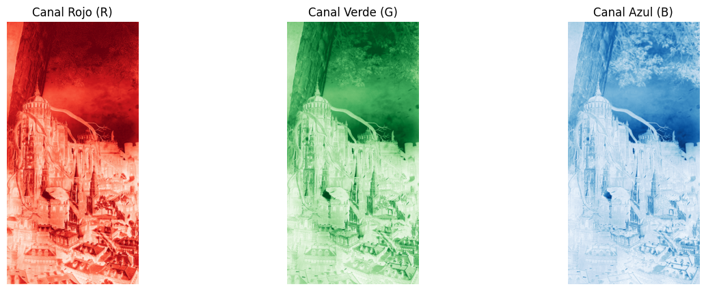
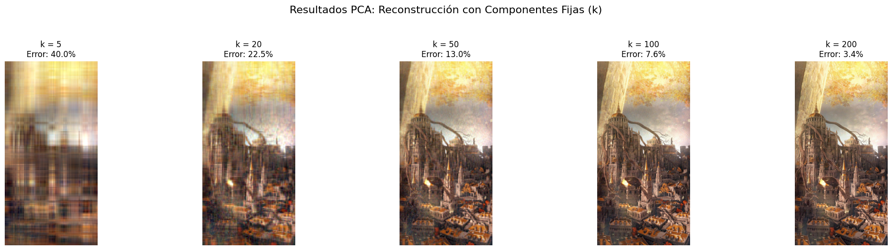
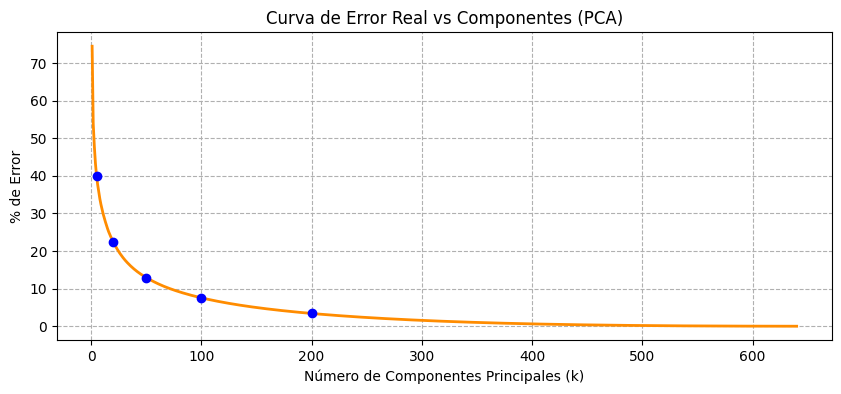
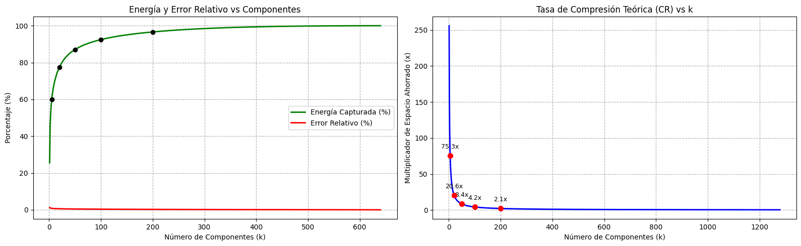

# Image Compression with SVD and PCA

**English** | [Español](#compresión-de-imágenes-con-svd-y-pca)

Compression of an RGB image using Singular Value Decomposition (SVD) and Principal Component Analysis (PCA), with an analysis of error, explained variance and compression ratio for different numbers of components.

Team project with Arturo Millán, for the Cálculo Científico course (Facultad de Ciencias, UCV).

## What the project does
1. Loads an image from a public Google Drive link and checks its format, size and color mode (RGB).
2. Splits the image into its red, green and blue channels, each as a matrix.
3. Centers each channel, applies SVD and obtains the principal components and their variance.
4. Reconstructs each channel using the first *k* components, for k = 5, 20, 50, 100 and 200.
5. Measures the explained energy, the relative error and the compression ratio for each value of k.

## Main results
The test image is 640 × 1280 pixels (1280 rows × 640 columns, 3 channels).

| k   | Explained variance | Relative error | Compression ratio |
|-----|--------------------|----------------|-------------------|
| 5   | 60.00 %            | 19.17 %        | 75.29 × smaller   |
| 20  | 77.47 %            | 14.39 %        | 20.65 × smaller   |
| 50  | 87.04 %            | 10.91 %        | 8.42 × smaller    |
| 100 | 92.44 %            | 8.34 %         | 4.24 × smaller    |
| 200 | 96.60 %            | 5.59 %         | 2.13 × smaller    |

As k grows, the error falls and the image is more faithful, but the compression ratio also falls. The k value is a trade-off between quality and storage.

## Visualizations










## Project structure
```
image-processing-svd-pca/
├── procesamiento-imagenes.ipynb
├── imagen_original.png
├── canales_RGB.png
├── curva_error_pca.png
├── reconstrucciones_k.png
├── error_por_k.png
├── energia_error_cr.png
└── README.md
```

## How to reproduce
1. Open `procesamiento-imagenes.ipynb` in Google Colab or Jupyter.
2. Replace the URL in the variable `url_publica_drive` with the Google Drive link of any public image (the link must be shared as "Anyone with the link").
3. Run the cells from top to bottom.

Required libraries: `numpy`, `matplotlib`, `pillow`, `requests`.

## Author
Arturo Millán and Franyer Pérez

---

# Compresión de imágenes con SVD y PCA

[English](#image-compression-with-svd-and-pca) | **Español**

Compresión de una imagen RGB usando la Descomposición en Valores Singulares (SVD) y el Análisis de Componentes Principales (PCA), con un análisis del error, la varianza explicada y la tasa de compresión para distintos números de componentes.

Proyecto en equipo con Arturo Millán, para la materia Cálculo Científico (Facultad de Ciencias, UCV).

## Qué hace el proyecto
1. Carga una imagen desde un enlace público de Google Drive y verifica su formato, tamaño y modo de color (RGB).
2. Separa la imagen en sus canales rojo, verde y azul, y cada canal lo convierte en una matriz.
3. Centra cada canal, aplica SVD y obtiene los componentes principales y su varianza.
4. Reconstruye cada canal usando los primeros *k* componentes, para k = 5, 20, 50, 100 y 200.
5. Calcula la energía explicada, el error relativo y la tasa de compresión para cada valor de k.

## Resultados principales
La imagen de prueba mide 640 × 1280 píxeles (1280 filas × 640 columnas, 3 canales).

| k   | Varianza explicada | Error relativo | Tasa de compresión |
|-----|--------------------|----------------|--------------------|
| 5   | 60.00 %            | 19.17 %        | 75.29 veces menos  |
| 20  | 77.47 %            | 14.39 %        | 20.65 veces menos  |
| 50  | 87.04 %            | 10.91 %        | 8.42 veces menos   |
| 100 | 92.44 %            | 8.34 %         | 4.24 veces menos   |
| 200 | 96.60 %            | 5.59 %         | 2.13 veces menos   |

A medida que k aumenta, el error baja y la imagen se parece más a la original, pero la tasa de compresión también baja. El valor de k es un equilibrio entre calidad y almacenamiento.

## Visualizaciones


## Estructura del proyecto
```
image-processing-svd-pca/
├── procesamiento-imagenes.ipynb
├── imagen_original.png
├── canales_RGB.png
├── curva_error_pca.png
├── reconstrucciones_k.png
├── error_por_k.png
├── energia_error_cr.png
└── README.md
```

## Cómo reproducirlo
1. Abre `procesamiento-imagenes.ipynb` en Google Colab o en Jupyter.
2. Cambia la URL de la variable `url_publica_drive` por el enlace de Google Drive de cualquier imagen pública (el enlace debe estar compartido como "Cualquier persona con el enlace").
3. Ejecuta las celdas de arriba hacia abajo.

Librerías necesarias: `numpy`, `matplotlib`, `pillow` y `requests`.

## Autores
Arturo Millán y Franyer Pérez
